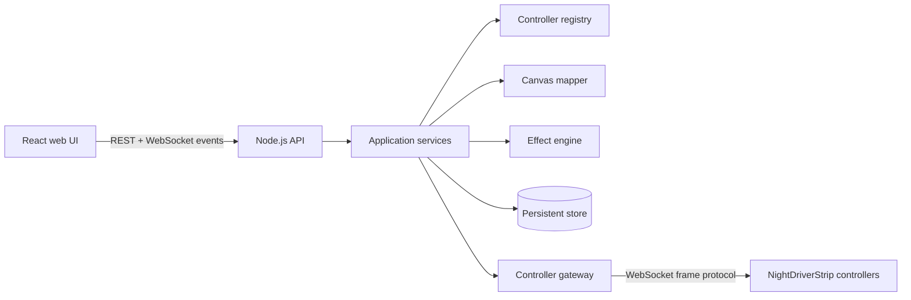

# LED-Central Architecture

## Purpose

LED-Central is a Linux-hosted control plane for multiple NightDriverStrip
controllers. It owns the user-facing model of controllers, strips, canvases,
effects, and playback. It does not contain embedded firmware. Physical LED
controllers remain external devices reached over the network.

## System Shape



The backend is the system of record. The browser displays state and submits
commands; it must not communicate directly with LED controllers. This keeps
device credentials, retry policy, frame timing, and protocol translation on
the Linux host.

## Runtime Components

### Frontend

The React application is organized around operator workflows:

- **Dashboard**: health, controller connectivity, and active playback.
- **Controllers**: discover, add, edit, test, and remove devices.
- **Canvases**: define logical layouts and map physical strips to coordinates.
- **Effects**: browse effect definitions and edit validated parameters.
- **Playback**: select a canvas and effect, preview it, start, pause, and stop.

The frontend talks to the backend through a typed API client. REST handles
queries and commands. A browser WebSocket receives state changes, connection
updates, and playback telemetry; it is not the device frame transport.

### Backend

The backend should evolve from the current `server.js` scaffold into these
modules:

```text
backend/src/
├── server.js                 # process startup and HTTP composition
├── config/                   # environment parsing and defaults
├── api/                      # routes, request validation, response mapping
├── application/              # use cases and orchestration
├── domain/                   # controller, strip, canvas, effect, playback
├── infrastructure/
│   ├── persistence/          # repository implementations
│   ├── controllers/          # device gateway and protocol adapter
│   └── realtime/             # browser WebSocket event publisher
└── shared/                   # errors, clocks, IDs, and common utilities
```

Routes should remain thin. They validate transport input, call one application
service, and map the result to an HTTP response. Domain objects should not
import Express, WebSocket libraries, or database clients.

### Controller Gateway

The gateway is an adapter around the existing NightDriverStrip network
protocol. Its interface should be device-oriented and transport-independent:

```text
connect(controller)
disconnect(controllerId)
getStatus(controllerId)
sendFrame(controllerId, frame)
sendFrames(controllerId, frames)
```

Each configured controller gets one managed connection. The gateway owns
connection lifecycle, reconnect backoff, send queue limits, timeouts, and
normalization of device errors. A controller is `online` only after a
successful connection or health response; a configured controller may remain
`offline` without being deleted.

## Core Domain Model

- **Controller**: stable ID, display name, host, port, capabilities, and
  connection status.
- **Strip**: physical output belonging to a controller, with LED count, color
  order, and optional calibration settings.
- **Canvas**: logical LED surface containing one or more strip mappings.
- **Strip mapping**: placement, orientation, coordinate transform, and output
  order for a strip on a canvas. Serpentine layouts are represented here, not
  as a special case in an effect.
- **Effect definition**: metadata, parameter schema, and renderer identifier.
- **Playback session**: selected canvas/effect, parameters, start time, frame
  rate, queue state, and lifecycle status.
- **Frame**: timestamped logical pixel data plus the target canvas revision.

The canvas mapper converts logical pixels into controller-specific frames. The
effect engine renders against a canvas coordinate space, so one effect can
span serial, parallel, and serpentine strip arrangements without knowing how
the LEDs are wired.

## Data Flow

1. The operator saves controller and canvas configuration through REST.
2. The application service validates the command and persists a new revision.
3. Playback loads the canvas revision and effect parameters.
4. The effect engine renders timestamped logical frames.
5. The canvas mapper splits and transforms each frame per physical strip.
6. The controller gateway queues and sends device frames.
7. Gateway status and playback events are published to connected browsers.

Rendering and transport should be decoupled. A slow or offline controller must
not block rendering for other controllers. The first implementation may use a
bounded in-memory queue, but queue overflow and dropped-frame behavior must be
observable and explicit.

## API Boundaries

The initial REST surface should grow from the current controller endpoints:

```text
GET    /api/health
GET    /api/controllers
POST   /api/controllers
GET    /api/controllers/:id
PATCH  /api/controllers/:id
DELETE /api/controllers/:id
POST   /api/controllers/:id/test

GET    /api/canvases
POST   /api/canvases
GET    /api/canvases/:id
PUT    /api/canvases/:id
DELETE /api/canvases/:id

GET    /api/effects
GET    /api/effects/:id

GET    /api/playback
POST   /api/playback/start
POST   /api/playback/pause
POST   /api/playback/stop
```

Commands should return the resulting resource or playback state. Validation
errors use HTTP 400 with field-level details; missing resources use 404;
conflicts such as a stale canvas revision use 409; unavailable devices use
503. Every response should include a request ID once structured logging is
introduced.

## Persistence and Reliability

Use repository interfaces in the application layer so storage can change
without changing use cases. The recommended progression is:

1. In-memory repositories for the first vertical slice and tests.
2. SQLite for local, single-host persistence of configuration and playback
   history.
3. Optional PostgreSQL only if multi-user or multi-host deployment becomes a
   real requirement.

Persist configuration before attempting device communication. On restart,
reload controllers, canvases, and effect settings, then reconnect controllers
without automatically resuming playback until resume behavior is explicitly
configured.

## Security and Operations

- Bind to localhost by default; make network binding explicit in configuration.
- Restrict CORS to configured frontend origins.
- Add authentication before exposing the service beyond a trusted LAN.
- Validate all network destinations and numeric limits supplied by users.
- Keep device traffic and browser traffic on separate adapters.
- Use structured logs with controller ID, playback ID, and request ID.
- Expose health separately from readiness: health means the process is alive;
  readiness includes required persistence and gateway initialization.

## Delivery Order

1. Extract configuration, validation, error handling, and controller repository.
2. Add controller gateway with a fake adapter for tests and a real WebSocket
   adapter for NightDriverStrip devices.
3. Replace the Vite demo with the controller dashboard and API client.
4. Add persistent controller and canvas configuration.
5. Implement canvas mapping with fixtures for series, parallel, and serpentine
   layouts.
6. Add one end-to-end effect and playback path before importing larger effect
   libraries.
7. Add browser realtime events, reconnect behavior, metrics, and authentication.

The first meaningful milestone is one effect rendered onto one canvas and sent
to multiple configured controllers, with a fake gateway proving the mapping
and queue behavior in automated tests.
