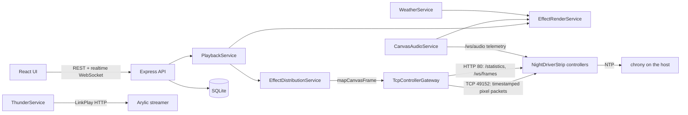

# LED-Central Architecture

LED-Central is a Node.js service plus a React UI. It owns the model of
controllers, canvases, effects and playback, renders every frame itself, and
sends the frames to NightDriverStrip controllers over the network. The
controllers only buffer frames and show each one at its timestamp.



## Source layout

```text
backend/src/
├── server.js          Composition: builds services, routes, realtime socket; restores playback
├── config/            Environment parsing and defaults
├── api/               Express routers (thin: validate, call a service, map the result)
├── application/       PlaybackService, EffectRenderService, distribution, audio, weather,
│                      thunder, alerts, settings, database validation
├── domain/
│   ├── canvases/      normalizeCanvas, mapCanvasFrame, preview grids
│   ├── effects/       Effect definitions (default-effects.js), weather renderer
│   └── display/       Bitmap fonts, weather icons, sun/moon math for matrix displays
└── infrastructure/
    ├── controllers/   TCP gateway, fake gateway (tests), host resolver
    ├── persistence/   SQLite repositories
    ├── realtime/      Browser WebSocket server
    └── metrics/       Request metrics, host CPU
```

## Domain model

- **Controller**: name, host, port (49152), strip count, LED count and LED
  density (LEDs/m) per strip, and whether it has a microphone. Filled in by
  *Detect from device*, which reads the controller's `/statistics`.
- **Canvas**: a `width x height` grid with one *mapping* per physical strip.
  A mapping places a controller strip (`controllerId`, zero-based
  `stripIndex`) at `x, y` with a `width x height`, a layout (`series`,
  `parallel` or `serpentine`), rotation, direction and, for serpentine, the
  corner LED 0 sits in and the axis of the first run. A canvas also has a
  `stripSpacingRatio` (strip-to-strip spacing over LED-to-LED spacing, used by
  effects that spread sideways) and an optional `soundStreamer`. A strip can
  belong to only one canvas.
- **Effect**: an id, name, renderer id, parameter schema with defaults, tags
  and sort order. The built-in definitions live in
  `domain/effects/default-effects.js` and are seeded into the database; see
  [EFFECTS.md](EFFECTS.md).
- **Playback session**: one per canvas: effect, parameters, frame rate, start
  time and a session seed. Its *intent* is persisted so a restart resumes it.

## Rendering and timing

`PlaybackService` runs one session per canvas on a timer at the session's
frame rate (20 fps by default, 1-60 allowed).

1. **Lookahead.** Each tick tops the session up to `targetQueueMs` (1.5 s)
   of future frames, one frame interval at a time, so delivery is paced at
   the real frame rate rather than in bursts. Audio-reactive effects keep only
   2 frames ahead, so they don't lag the sound.
2. **Render.** `EffectRenderService` calls the effect's renderer with the
   canvas, its parameters, the frame's timestamp and `timeSeconds` since the
   session started. Renderers are pure functions of time and parameters (plus
   cached simulation state for fire), so a frame is the same whenever it is
   rendered. Inputs added per frame:
   - **Session seed**: with *true random* on (the default), a fresh seed from
     the OS random source per run; off, fixed seeds so runs repeat exactly.
   - **LED density** of each mapping, resolved live from the controller at
     playback start, so sizes tuned in LEDs on a 60 LED/m strip scale to the
     real strip (`densityScaledSize` and friends).
   - **Audio** (`CanvasAudioService`) for audio effects: band levels, VU and
     beats from the controllers' microphones.
   - **Weather** (`WeatherService`) for weather effects, always from cache.
3. **Catch-up.** If a session falls more than 4 frames behind (a long stall),
   it skips ahead to "now" instead of replaying the gap, and logs
   `[playback] ... skipping ahead`: the firmware only shows the newest due
   frame, so replaying would be wasted writes.
4. **Timestamps.** Every frame carries the wall-clock time it should appear.
   One canvas frame is rendered once and split per controller with the same
   timestamp, so the controllers' clocks decide how well they line up (see
   [Clock synchronization](#clock-synchronization)).

## Canvas mapping

`mapCanvasFrame` turns one canvas frame into one pixel list per mapping, in
the strip's wire order: walking the mapping's rectangle row by row with its
rotation, reversing it if the strip runs the other way, or zig-zagging for a
serpentine matrix. Each result is tagged with the controller and a channel
bitmask (`1 << stripIndex`). Effects never see wiring; a renderer only draws
the logical grid. `previewGridForMapping` reverses the mapping to show a
serpentine matrix as a picture on the Status tab.

## Delivery: the controller gateway

`TcpControllerGateway` keeps one TCP connection per controller strip
(controller + channel mask) to port 49152.

- **Packets.** NightDriverStrip's `WIFI_COMMAND_PIXELDATA64` (command 3):
  channel mask, LED count, seconds and microseconds of the timestamp, RGB
  bytes. Each packet is zlib-compressed inside the firmware's compressed-packet
  wrapper when that is smaller.
- **Replies.** The controller answers each pixel packet with a status struct
  (`SocketResponse`: clock, buffer depth, WiFi signal, draw fps). The gateway
  keeps the WiFi signal for its logs.
- **Isolation.** Sends are queued per strip and never block the playback tick,
  so one stalled controller can't freeze a canvas that spans several. Frames
  that come due while a write is stuck are dropped, except the newest.
- **Reconnects.** A failed write reconnects; a controller that stays
  unreachable is retried in the background with backoff, and playback keeps
  ticking, so it lights up again on its own after a reboot or WiFi dropout.
  Outages and recoveries are logged with their duration.
- **Host names.** `host-resolver.js` resolves `.local` names once at a time
  per host and keeps the last good address, because a dead mDNS name holds a
  Node DNS thread for about 5 s and several of them used to starve the pool.
- **Statistics and previews.** The gateway also polls each controller's
  `/statistics` over HTTP (draw fps, nightly schedule state, density) and,
  while the Status tab is open, streams `/ws/frames` for live previews.

## Clock synchronization

Controllers show a frame when their own clock reaches its timestamp, so their
clocks must agree with this host's. `setup-linux.sh` configures chrony to
serve NTP to the local network. The fork's firmware syncs to the host that is
sending it frames (every 60 s while frames arrive, steering a quarter of the
measured offset each time), and falls back to its configured internet NTP
server otherwise. Measured on 2026-10-25, all seven controllers were within
±6 ms of the host. Each controller reports its last sync in `/statistics`
(`NTP_SOURCE`, `NTP_OFFSET_MS`).

## Audio

`CanvasAudioService` subscribes to the `/ws/audio` WebSocket of every
microphone-equipped controller on a canvas (raw per-band FFT magnitudes, VU,
beat detection). It converts band magnitudes to a 50 dB display range with
automatic gain control, keeps peak-hold markers, and hands renderers a single
audio snapshot per canvas. Whether a controller has a microphone is probed on
connect and cached (**Recheck Audio** in the UI probes again).

## Sound and alerts

- **ThunderService** plays a thunder clip on the canvas's sound streamer
  (Arylic/LinkPlay HTTP API) for each Halloween lightning strike. Strike times
  come from the same seeded schedule the renderer uses, and the play command
  goes out `thunderLeadMs` early to cover the streamer's start-up delay. It
  follows the controllers' nightly schedule: the quieter clip while dimmed,
  nothing while off. Clips are served from `backend/media/sounds` at
  `/sounds/<file>`.
- **WeatherAlertNotifier** rings the speaker on matrices showing a weather
  effect when Environment Canada issues a new alert for their postal code.

## Persistence

SQLite (`better-sqlite3`, at `EFFECT_DATABASE_PATH`) holds `controllers`,
`canvases`, `effects`, `playback_intents` and `settings`. Configuration is
saved before any device is contacted. At startup,
`DatabaseValidationService` checks the stored data against what the code
supports and repairs anything that would stop startup (for example a playback
intent for an effect that no longer exists); everything else is reported.
`restore()` then restarts each saved session; a session whose controllers are
offline keeps ticking and resumes when they return.

## API and realtime

REST under `/api` (see [backend/README.md](../backend/README.md)). The
browser WebSocket at `/api/realtime` carries events on the `controller`,
`playback` and `distribution` topics; it is never used for device traffic.
`/api/status` aggregates canvases, sessions and per-strip telemetry for the
Status tab, and `/api/metrics` exposes request metrics.

Optional shared-token authentication: with `AUTH_TOKEN` set, every `/api`
route requires `Authorization: Bearer <token>` and the realtime socket
requires `?token=`. There are no user accounts; keep LED-Central on a trusted
network.

## Testing

`make test` runs the backend's Node test suite (renderers, canvas mapping,
gateway framing, playback timing, persistence) against a fake gateway;
`npm run lint` in `frontend/` checks the UI. Changes are also verified on the real installation:
the Pi, its seven controllers, and frame captures from `/ws/frames`.
